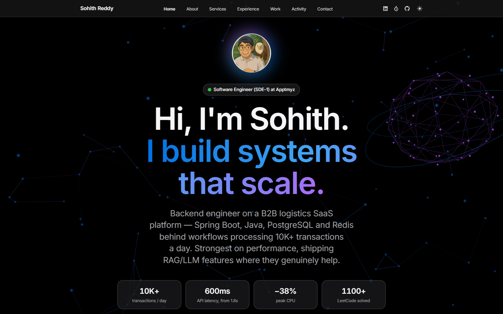
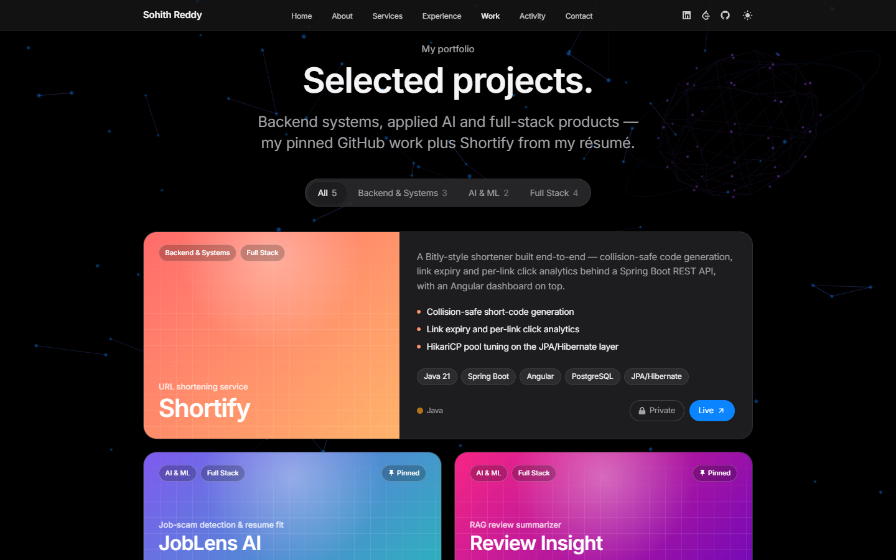
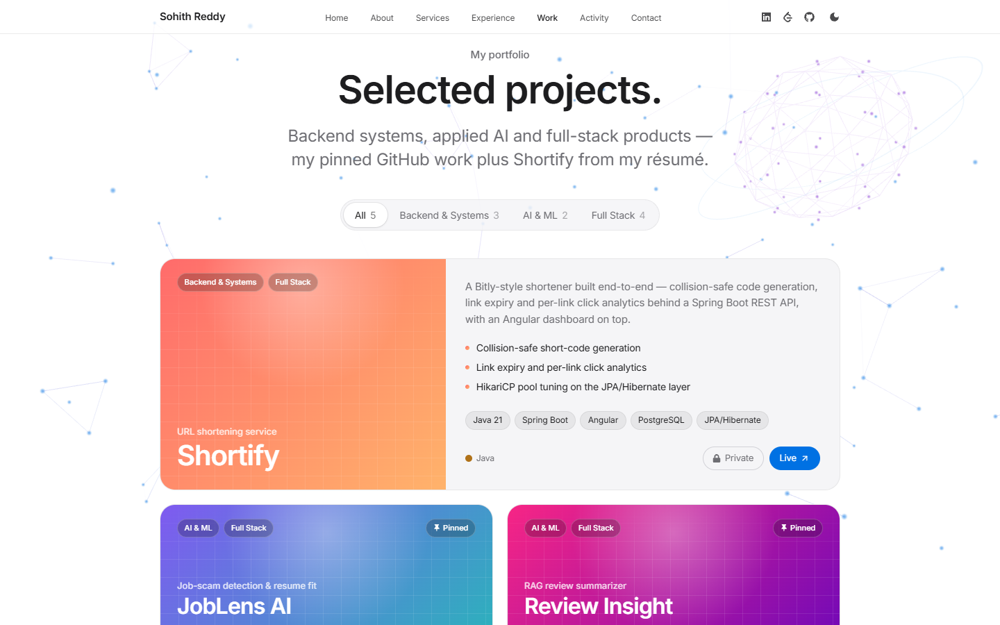
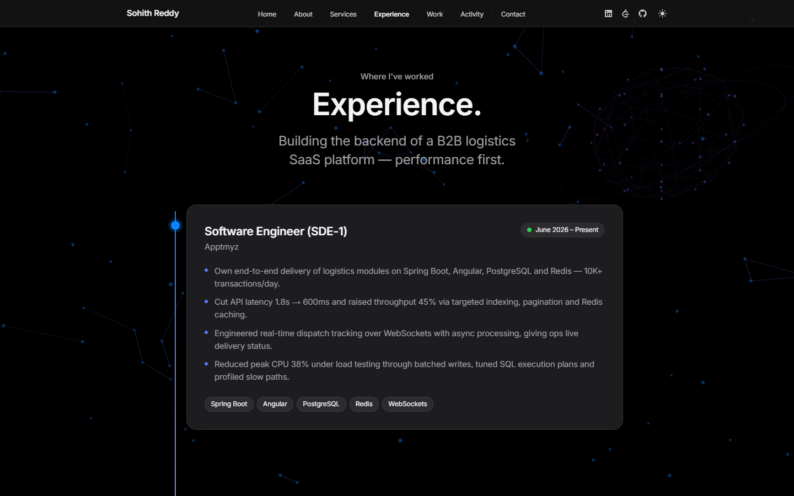
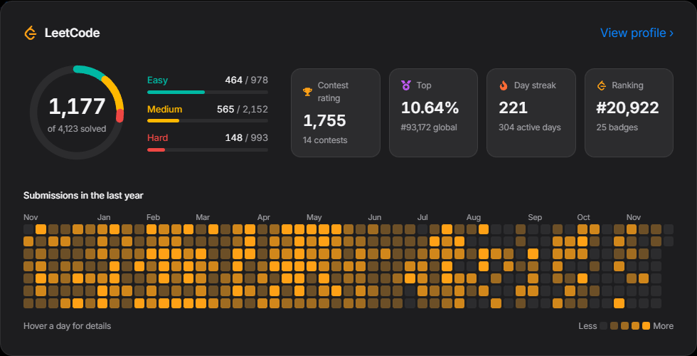
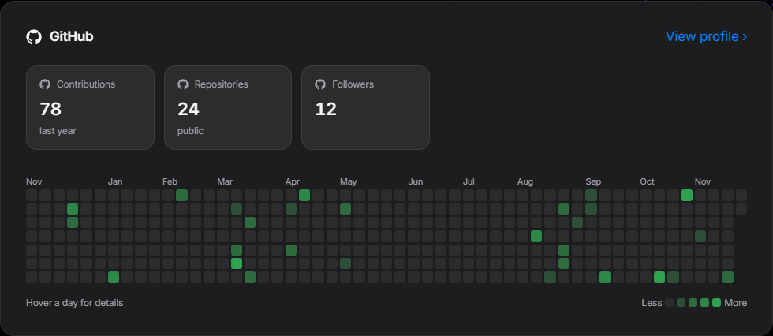
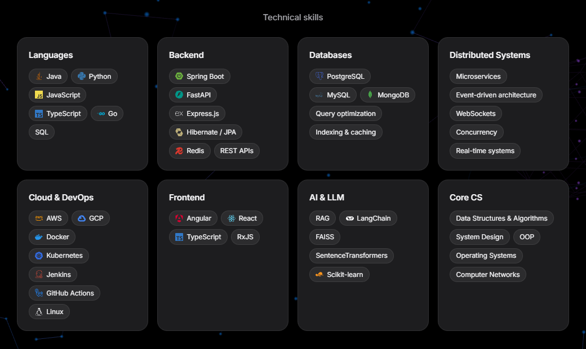
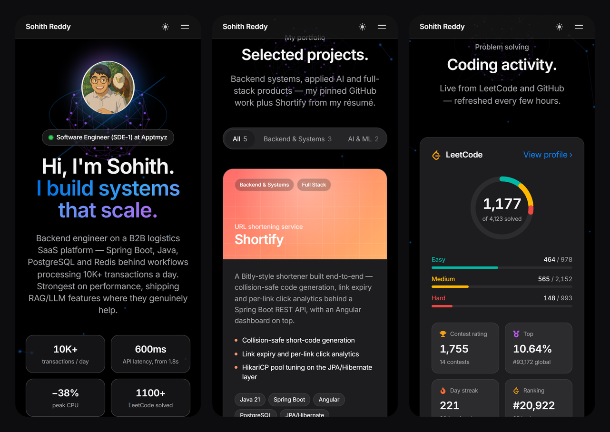

<div align="center">


# Sohith Reddy · Portfolio

**Software Engineer building backend systems that scale.**<br/>
Next.js · Three.js · live LeetCode and GitHub activity

[](https://www.sohithreddy.dev/)
[](https://nextjs.org)
[](https://react.dev)
[](https://threejs.org)
[](https://tailwindcss.com)

[**Live site**](https://www.sohithreddy.dev/) · [Résumé](https://www.sohithreddy.dev/Resume.pdf) · [Backend](https://github.com/Sohith-reddy/Portfolio-Backend) · [Report a bug](https://github.com/Sohith-reddy/Portfolio/issues)

<br/>

<picture>
  <source media="(prefers-color-scheme: dark)" srcset="docs/screenshots/hero-dark.png" />
  <source media="(prefers-color-scheme: light)" srcset="docs/screenshots/hero-light.png" />
  
</picture>

</div>

<br/>

## ✨ Highlights

<table>
  <tr>
    <td width="50%" valign="top">
      <h4>🌐 3D background</h4>
      A Three.js network graph of drifting nodes linked by proximity edges, around a wireframe core. It follows the light/dark theme, reacts to the mouse and scroll, pauses in hidden tabs, and shows a still frame when the visitor prefers reduced motion.
    </td>
    <td width="50%" valign="top">
      <h4>📈 Live coding activity</h4>
      LeetCode solved count by difficulty, contest rating, streak, top topics and languages, plus submission and GitHub contribution heatmaps. Fetched on the server and cached for 6 hours.
    </td>
  </tr>
  <tr>
    <td width="50%" valign="top">
      <h4>🗂️ Categorized projects</h4>
      Pinned GitHub repositories, filterable by <i>Backend & Systems</i>, <i>AI & ML</i> and <i>Full Stack</i>. Cards have a cursor spotlight, a subtle 3D tilt, and Code / Live links.
    </td>
    <td width="50%" valign="top">
      <h4>🌗 Light & dark</h4>
      Apple-inspired design tokens with an explicit theme toggle that remembers your choice and otherwise follows the OS, with no flash of the wrong theme on load.
    </td>
  </tr>
</table>

## 📸 Screenshots

### Projects



<table>
  <tr>
    <td width="50%"></td>
    <td width="50%"></td>
  </tr>
  <tr>
    <td align="center"><sub>Projects · light theme</sub></td>
    <td align="center"><sub>Experience timeline</sub></td>
  </tr>
</table>

### Coding activity





### Technical skills



### Mobile



## 🧱 Tech stack

| Area | Stack |
|:--|:--|
| **Framework** | Next.js 16 (App Router, Turbopack), React 19 |
| **Styling** | Tailwind CSS 4, CSS design tokens for light/dark |
| **Motion & 3D** | Motion, Three.js |
| **Icons** | React Icons |
| **Data** | LeetCode GraphQL and GitHub contributions, fetched server-side with ISR |
| **Contact form** | Web3Forms |
| **Visit tracking** | [Portfolio-Backend](https://github.com/Sohith-reddy/Portfolio-Backend), a Spring Boot service with PostgreSQL |
| **Hosting** | Vercel |

## 🗺️ How it works

```
app/
├── page.js                 # Server component; revalidates every 6 hours
├── layout.js               # Metadata, theme bootstrap, fonts
├── icon.png, opengraph-image.png, …   # Favicon and social preview images
└── components/
    ├── ThreeBackground.jsx # WebGL network graph (client only)
    ├── CodingStats.jsx     # Server: fetches LeetCode + GitHub data
    ├── CodingStatsView.jsx # Client: ring, stat tiles, bar charts
    ├── Heatmap.jsx         # 53-week contribution grid
    ├── Work.jsx            # Category filter + project cards
    └── …                   # Header, About, Services, Experience, Contact
assets/assets.js            # All content: projects, skills, experience
utils/stats.js              # LeetCode / GitHub fetchers
utils/trackVisit.js         # Optional visit tracking
```

- **Content lives in one file.** To add a project, skill or role, edit [`assets/assets.js`](assets/assets.js).
- **Stats never hit the browser.** LeetCode blocks cross-origin requests, so [`utils/stats.js`](utils/stats.js) fetches during build and revalidation. If a source is down, the section falls back gracefully instead of failing the build.

## 💻 Local development

```bash
git clone https://github.com/Sohith-reddy/Portfolio.git
cd Portfolio
npm install
npm run dev          # http://localhost:3000
```

| Script | What it does |
|:--|:--|
| `npm run dev` | Dev server with Turbopack |
| `npm run build` | Production build (fetches live stats) |
| `npm run start` | Serve the production build |
| `npm run lint` | ESLint |

### Environment variables

Copy `.env.example` to `.env.local`, or set it in the Vercel project settings:

```env
# Base URL of the deployed Portfolio-Backend service, without a trailing slash.
# When unset, visit tracking is disabled.
NEXT_PUBLIC_API_URL=https://portfolio-backend-xxxxxxxxxx-el.a.run.app
```

Visits are sent once per browser session to `POST {NEXT_PUBLIC_API_URL}/api/track`. Append `?ref=<name>` to the site URL to tag visits from a specific link, such as a job application.

<br/>

<div align="center">

## 🤝 Connect

[](https://www.linkedin.com/in/sohithreddy/)
[](https://github.com/Sohith-reddy)
[](https://leetcode.com/u/sohith_reddy01/)
[](https://twitter.com/Sohith_01)

<sub>Designed and built by Sohith Reddy</sub>

</div>
